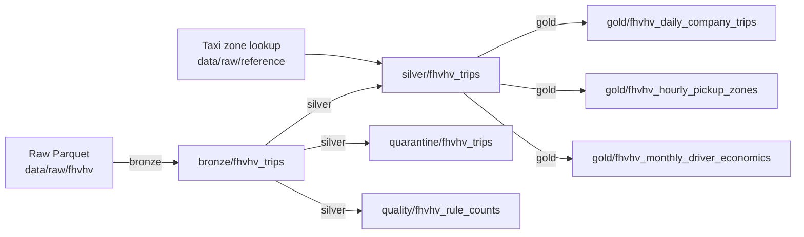
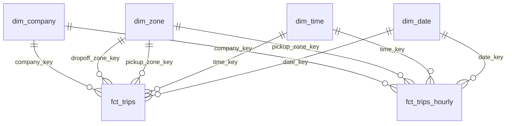

# Data model

All tables are Delta Lake tables partitioned by `data_month` (the first day of the month). Every run replaces
exactly one month in each table it writes ([ADR 0003](adr/0003-idempotent-monthly-partition-overwrite.md)).
Locally they live under `data/lakehouse/`.

## bronze/fhvhv_trips

Source rows conformed to the schema contract ([ADR 0007](adr/0007-explicit-bronze-schema-contract.md)).

| Column | Type | Notes |
|---|---|---|
| 25 source columns | as in `contracts.py` | `cbd_congestion_fee` is null before 2025 |
| `_source_file` | string | Name of the raw file |
| `_ingested_at` | timestamp | When the month was loaded; changes on a rerun |
| `data_month` | date | Partition column |

## silver/fhvhv_trips

Rows that passed every reject rule ([ADR 0006](adr/0006-data-quality-rules-and-silver-schema.md)).

| Column | Type | Notes |
|---|---|---|
| 25 source columns | as in bronze | Timestamps are New York local time (`timestamp_ntz`) |
| `pickup_borough`, `pickup_zone` | string | From the TLC taxi zone lookup; null if the zone ID is not in the lookup |
| `dropoff_borough`, `dropoff_zone` | string | Same |
| `quality_warnings` | array&lt;string&gt; | IDs of the warning rules the row triggered, for example `["W001"]` |
| `_source_file` | string | Lineage back to the raw file |
| `data_month` | date | Partition column |

## quarantine/fhvhv_trips

Rows that failed at least one reject rule ([ADR 0004](adr/0004-quarantine-failed-rows.md)). Nothing is
dropped silently: every rejected row is here with the reason.

| Column | Type | Notes |
|---|---|---|
| 25 source columns | as in bronze | Original values |
| `failed_rules` | array&lt;string&gt; | IDs of the reject rules the row failed, for example `["Q004", "Q005"]` |
| `quality_warnings` | array&lt;string&gt; | Warning rules the row also triggered |
| `_source_file` | string | |
| `data_month` | date | Partition column |

## quality/fhvhv_rule_counts

One row per rule per month. A sudden change in these counts is the signal that the source changed.

| Column | Type | Notes |
|---|---|---|
| `data_month` | date | Partition column |
| `rule_id` | string | `Q001`-`Q007`, `W001`-`W005` |
| `severity` | string | `reject` or `warning` |
| `description` | string | Short rule description |
| `matched_rows` | bigint | Rows of the month that matched the rule |
| `total_rows` | bigint | Rows of the month in bronze |

A row can match several rules, so `matched_rows` of different rules do not add up to the quarantine size.

## gold/fhvhv_daily_company_trips

Trips and money per pickup day per company ([ADR 0008](adr/0008-gold-tables.md)).

| Column | Type | Notes |
|---|---|---|
| `data_month` | date | Partition column |
| `trip_date` | date | Pickup date, New York local time |
| `company` | string | Uber, Lyft, Juno, Via, or `Other (<code>)` |
| `hvfhs_license_num` | string | Licensee code |
| `trips` | bigint | |
| `base_fare_total`, `tips_total`, `driver_pay_total` | double | Rounded to cents |
| `passenger_paid_total` | double | Base fare plus every charge and tip |
| `avg_trip_miles`, `avg_trip_minutes` | double | |

## gold/fhvhv_hourly_pickup_zones

| Column | Type | Notes |
|---|---|---|
| `data_month` | date | Partition column |
| `pickup_date` | date | |
| `pickup_hour` | int | 0-23, New York local time |
| `PULocationID`, `pickup_borough`, `pickup_zone` | int, string, string | |
| `trips` | bigint | |

## gold/fhvhv_monthly_driver_economics

| Column | Type | Notes |
|---|---|---|
| `data_month` | date | Partition column |
| `company`, `hvfhs_license_num` | string | |
| `trips` | bigint | |
| `driver_pay_total`, `trip_miles_total`, `trip_minutes_total` | double | |
| `driver_pay_per_mile`, `driver_pay_per_minute` | double | Ratio of totals; null when the denominator is 0 |
| `driver_share_of_base_fare` | double | Total driver pay / total base fare |

## Star schema

A dimensional model on top of silver, for BI tools such as Power BI
([ADR 0014](adr/0014-star-schema-and-powerbi-export.md)). The facts are rebuilt one month at a time like every
other table; the dimensions are rebuilt whole, except `dim_company`, which is merged.

## gold/fhvhv_fct_trips

One row per trip that passed every reject rule.

| Column | Type | Notes |
|---|---|---|
| `trip_key` | bigint | Hash of every source column plus a sequence number for identical rows; unique |
| `date_key` | int | Pickup date as yyyymmdd, New York local time |
| `time_key` | int | Pickup hour, 0-23 |
| `pickup_zone_key`, `dropoff_zone_key` | int | TLC `LocationID`; both point at `dim_zone` |
| `company_key` | bigint | Hash of the licence code |
| `trip_miles`, `trip_time` | double, bigint | As in the source; `trip_time` in seconds |
| `base_passenger_fare`, `tolls`, `bcf`, `sales_tax`, `congestion_surcharge`, `airport_fee`, `cbd_congestion_fee`, `tips`, `driver_pay` | double | As in the source |
| `total_fare` | double | Everything the passenger paid, same as gold `passenger_paid_total` |
| `wait_time_seconds` | bigint | Pickup minus request time; null when negative or when the request time is missing |
| `data_month` | date | Partition column |

## gold/fhvhv_fct_trips_hourly

One row per pickup date, pickup hour, pickup zone and company. Built from `fct_trips`, so its totals reconcile
with it. Sums and counts only: averages are computed from them.

| Column | Type | Notes |
|---|---|---|
| `date_key`, `time_key`, `pickup_zone_key`, `company_key` | | The grain |
| `trips` | bigint | |
| `trip_miles_sum`, `trip_time_sum` | double, bigint | |
| `<money column>_sum` | double | One per money column of `fct_trips`, including `total_fare_sum`; rounded to cents |
| `wait_time_seconds_sum` | bigint | Over the trips with a valid wait time |
| `wait_time_trips` | bigint | Trips with a valid wait time: the denominator of the average wait |
| `data_month` | date | Partition column |

## gold/fhvhv_dim_date

One row per day from 2024-01-01 to 2027-12-31: `date_key` (yyyymmdd), `date`, `year`, `quarter`, `month`,
`month_name`, `month_start`, `day_of_month`, `day_of_week` (1 = Monday), `day_name`, `is_weekend`.

## gold/fhvhv_dim_time

24 rows: `time_key` and `hour` (0-23), `hour_label` (`07:00`), `day_part` (Night from 00:00, Morning from 06:00,
Afternoon from 12:00, Evening from 18:00) and `is_peak_hour` (07:00-09:59 and 16:00-19:59).

## gold/fhvhv_dim_zone

One row per TLC taxi zone: `zone_key` and `location_id` (TLC `LocationID`), `borough`, `zone`, `service_zone`,
and `is_airport` (JFK, LaGuardia and Newark).

## gold/fhvhv_dim_company

One row per licence code: `company_key`, `hvfhs_license_num`, `company_name` (Uber, Lyft, Juno, Via, or
`Other (<code>)`).
